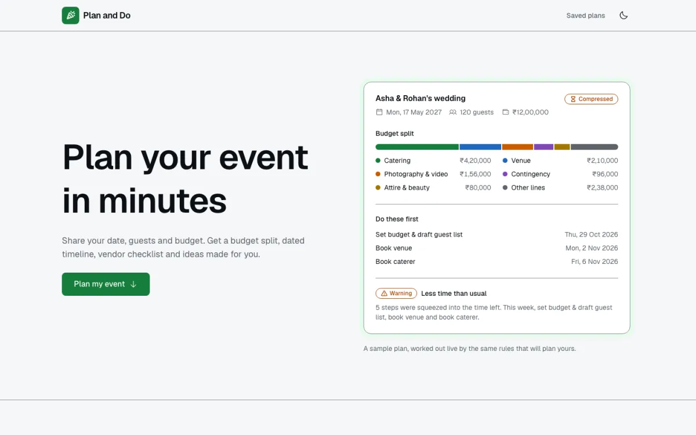
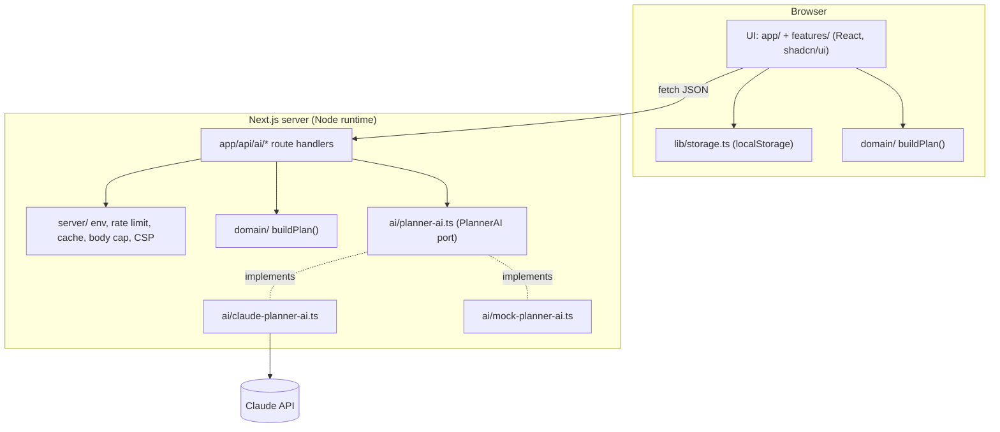
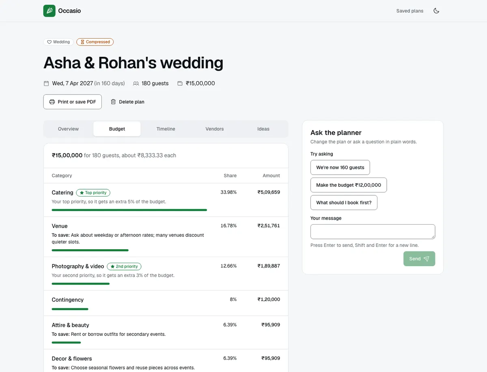

# Plan and Do

A GenAI planning assistant for weddings, birthdays and community events. Describe the event in a
two-minute form and get a budget split, a dated timeline, a vendor checklist and personalised
ideas. Then change the plan by talking to it.



## 1. Chosen vertical

**Celebration & Event Planner (Challenge 5).**

Plan and Do is for people who plan an event without a professional planner:

- **First-time hosts** planning a wedding or a milestone birthday, who need to know what to do
  and when, where the money should go and which vendors to book.
- **Community organisers** running a fundraiser, festival or clean-up, who need permits, safety
  and a budget they can defend.
- **Busy parents** with a child's party in two or three weeks, who need a short, realistic list
  and ideas that fit a small budget.

## 2. Approach and logic

### A hybrid brain: rules for the numbers, Claude for the ideas

| Concern                                            | Rules engine (`src/domain/`) | Claude                 |
| -------------------------------------------------- | ---------------------------- | ---------------------- |
| Money adds up exactly, dates are valid and ordered | Deterministic, unit tested   | Can slip on arithmetic |
| Explains why                                       | Every rule has a reason      | Partly                 |
| Creative, cultural, seasonal                       | No                           | Yes                    |
| Works with no key, costs nothing                   | Yes                          | No                     |

So the engine decides **what, how much and when**, and Claude adds **ideas and nuance on top**.
Claude is told the numbers and dates are final and may only reference vendor and budget-line ids
the engine produced. The decision is recorded in
[docs/adr/0002](docs/adr/0002-hybrid-rules-and-llm.md).

### The decision rules in brief

Full specification: [plan/05-decision-engine.md](plan/05-decision-engine.md).

- **Context.** Lead time, budget per guest, size class (intimate to very large), budget tier
  against reference costs, and timeline mode (on track, compressed or urgent).
- **Budget.** A base split per event type, then context modifiers: a venue you already have frees
  80% of that line; an outdoor event adds a weather line; more than 150 guests (not birthdays)
  adds a day-of coordinator; accessibility needs add their own line. Your top 3 priorities get
  +5%, +3% and +2%, funded in proportion by the other lines, none falling below 1%. All maths is
  in integer minor units with `BigInt` and the largest-remainder method, so the lines always sum
  to the exact total.
- **Timeline.** Each event type has a milestone template worked back from the date. If time is
  short, only the milestones that no longer fit are spread between today and the first one that
  still fits; below the critical lead time the non-critical ones move to "If time allows".
- **Vendors.** A catalog of 20 vendors and services, each with a condition (for example permits
  for community events, security above 300 guests), a book-by date taken from its milestone, a
  reason and 3 to 5 questions to ask, personalised with your dietary and access needs.
- **Warnings.** Tight or moderate budget, a cheaper weekday nearby, compressed or urgent timeline,
  outdoor, large crowd and dietary needs at scale. Each says what is wrong, why (in your own
  numbers) and what to do.

Both worked examples in plan/05 (a ₹12,00,000 wedding for 120 guests, and a wedding 136 days
away) are golden tests and match to the rupee and the day.

## 3. How the solution works



### The request flow

1. **Instant plan, no network.** The form validates the brief with the same Zod schema the
   server uses. The browser runs `buildPlan(brief, today)` and the plan page renders at once. Only
   the brief is saved; the plan is rebuilt from it on every load.
2. **Ideas, one Claude call.** The ideas tab calls `POST /api/ai/ideas`. The server caps the body
   at 16 KB, rate-limits, re-validates the brief, rebuilds the plan itself, checks its cache, then
   makes one structured-output call. If it fails, the budget, timeline and checklist stay complete
   and the user can retry.
3. **Refine, one tool.** "Ask the planner" sends the brief, the last 10 text-only turns and the
   message to `POST /api/ai/refine`. Claude may call `update_event_brief`; the server merges only
   whitelisted fields, re-validates and rebuilds the plan, then returns the new brief. The page
   updates, and existing ideas are marked out of date until refreshed.

### How Claude is used

- Official `@anthropic-ai/sdk`, model `claude-opus-5-5` (override with `ANTHROPIC_MODEL`). Only
  `src/ai/claude-planner-ai.ts` imports the SDK; ESLint enforces it.
- **Ideas:** `beta.messages.parse` with a Zod output format (`PlanIdeasSchema`), effort `medium`,
  and a cached system prompt. Output referencing unknown vendors or budget lines is dropped.
- **Refine:** the SDK Tool Runner with one strict tool, capped at 3 iterations, effort `low`.
- Server-side fallbacks (`fallbacks: "default"`) retry a declined request on another model.
  A refusal maps to `AI_DECLINED`; timeouts, 5xx, a `max_tokens` cut-off or output that fails the
  schema map to `AI_UNAVAILABLE`. Users only ever see friendly messages.
- **Guardrails:** user text goes only inside `<event_brief>` tags and the system prompt treats it
  as data; output is schema-constrained and rendered as plain React text; the only tool can edit
  only this user's brief and every edit is re-validated.

### Without a key: mock mode

With no `ANTHROPIC_API_KEY`, the app runs a deterministic mock adapter. It writes sample ideas
from the real plan's ids and understands simple refine messages ("80 guests", "budget 6 lakh",
"move to 2027-05-02"). The UI says it is in demo mode. Evaluators, CI and the E2E tests all use
it, so nothing costs money and nothing crashes for lack of a key.



## 4. Assumptions

1. The user is a planner, not a guest; one person plans one event at a time.
2. A plan lives in one browser. Clearing site data deletes it, and the UI says so.
3. Budget splits and per-guest reference costs are rough rules of thumb from common planning
   guides: a starting point, not quotes. They live in one place each
   (`src/domain/reference/budget-lines.ts`, `src/domain/reference/costs.ts`).
4. Reference costs exist for INR, USD, EUR and GBP. For AUD, CAD, SGD and AED the budget-tier
   check is skipped and no budget warning fires.
5. Dates are calendar dates in the user's local timezone; times of day are not modelled.
6. To write ideas, the event details are sent to Anthropic's Claude API. The UI and this README
   say so. The app never asks for names of private people, phone numbers or street addresses
   (location is city or region only).
7. The rate limiter runs in memory, so its limits apply per server instance and reset on restart.
   That is fine for a single-instance demo; the upgrade path is a shared store behind the same
   interface.
8. A saved plan's schedule is anchored to the day it was planned (`plannedOn`), so due dates do
   not move between visits and missed steps show as overdue. Any change to the brief re-plans
   from that day.

## 5. Features

All four outputs work for all three event types.

| Output in the brief | What you get                                                                                                                                                            |
| ------------------- | ----------------------------------------------------------------------------------------------------------------------------------------------------------------------- |
| Budgets             | A table with category, share and amount, priority lines marked, reasons for every change, a total that matches to the paisa or cent, and Claude's saving ideas per line |
| Timelines           | Milestones grouped by month with checkboxes, compressed and overdue badges, an "If time allows" group in urgent mode, and `.ics` export for any calendar                |
| Vendor checklists   | One card per vendor: why it is needed, the book-by date, the budget line it is paid from, questions to ask and Claude's tip, with a "Booked" checkbox                   |
| Personalised ideas  | 2 to 3 themes with decor, food and activities that respect dietary needs, ways to save, and considerations for your traditions, access needs and setting                |

Also: warnings with computed suggestions, refine by chat, saved plans with delete and undo,
progress that persists, print or save as PDF with every section expanded, light and dark themes,
and layouts from 320 px up.

## 6. Prerequisites, installation and running

- Node.js 24 LTS (see `.nvmrc`) and npm.

```bash
npm ci
cp .env.example .env.local      # optional: add ANTHROPIC_API_KEY for real Claude ideas
npm run dev                     # http://localhost:3000
```

Production build:

```bash
npm run build
npm start
```

**Running without a key:** leave `ANTHROPIC_API_KEY` empty (or skip `.env.local`). The app starts
in mock mode, and `GET /api/health` reports `{"status":"ok","aiMode":"mock"}`.

## 7. Configuration

Every variable is server-only; none starts with `NEXT_PUBLIC_`, so nothing reaches the browser.

| Variable                 | Default                               | Notes                                                                                                                                               |
| ------------------------ | ------------------------------------- | --------------------------------------------------------------------------------------------------------------------------------------------------- |
| `ANTHROPIC_API_KEY`      | none                                  | Secret. Missing means mock mode                                                                                                                     |
| `ANTHROPIC_MODEL`        | `claude-opus-5-5`                     | A cheaper model is a one-variable change                                                                                                            |
| `PLANNER_AI_MODE`        | `claude` with a key, otherwise `mock` | `claude` or `mock`                                                                                                                                  |
| `RATE_LIMIT_PER_MINUTE`  | `10`                                  | Per client, per AI route                                                                                                                            |
| `AI_DAILY_REQUEST_LIMIT` | `500`                                 | Global cap across all clients; protects the key's spend                                                                                             |
| `TRUST_PROXY`            | `false`                               | `true` only behind a proxy that sets `x-forwarded-for` (such as Vercel). Otherwise all clients share one bucket, because the header could be forged |

## 8. Testing

| Command                 | What it runs                                                                                                                                                                                     |
| ----------------------- | ------------------------------------------------------------------------------------------------------------------------------------------------------------------------------------------------ |
| `npm test`              | Vitest: domain rules, AI adapters with a fake SDK client, route handlers with a fake planner, storage, `.ics`, theme contrast and React components                                               |
| `npm run test:coverage` | The same, failing below 90% lines and branches for `src/domain` or 75% lines overall                                                                                                             |
| `npm run e2e`           | Playwright against a production build (`npm run build` first) in mock mode, with axe in light and dark themes on every page and tab                                                              |
| `npm run eval:ai`       | Manual, costs about $1: six fixture briefs and a refine turn against the real API, checking schema, references, vegan menus and a prompt-injection attempt (`-- --quick` for one per event type) |
| `scripts/presubmit.sh`  | The submission checks: public repo, one branch, size under 8 MB, no secrets, then every gate above                                                                                               |

CI (`.github/workflows/ci.yml`) runs lint, typecheck, coverage-gated tests, build, E2E, `npm
audit --audit-level=high`, a secret scan of the tree and history, and a repository-size guard on
every push to `main`.

## 9. Security, accessibility and efficiency

**Security** ([plan/09](plan/09-security.md)). The key lives only in server env and is redacted
from logs and serialisation; `server-only` stops server modules from reaching the client bundle.
Zod validates every boundary (form, API, storage, model output) with strict objects. AI routes
have a 16 KB body cap checked on the stream, per-client and daily limits, and a response cache.
A per-request nonce CSP (`script-src 'self' 'nonce-…' 'strict-dynamic'`, no `unsafe-eval` in
production, `frame-ancestors 'none'`) plus `nosniff`, `Referrer-Policy`, `Permissions-Policy` and
HSTS. No `dangerouslySetInnerHTML` (ESLint enforced). Logs carry counts and codes only, never the
brief or chat text.

**Accessibility** ([plan/08](plan/08-ui-ux-accessibility.md)). WCAG 2.1 AA: landmarks, a skip
link, one `h1` per page, labels above every input, errors linked with `aria-describedby` and a
focused error summary, Radix tabs, dialogs and radios, 44 px touch targets, status shown with an
icon and text (never colour alone), live regions for ideas and chat replies, a real table for
the budget, and `prefers-reduced-motion` honoured. A unit test checks every colour-token pair
against AA in both themes; axe reports zero serious or critical issues on every page; Lighthouse
accessibility is 100.

**Efficiency.** The plan needs no AI call to render. One Claude call covers all the ideas, cached
on the server (LRU, 1 hour) and in the browser (by brief fingerprint); the system prompt is
prompt-cached; chat uses low effort. Pages ship no chart library, and the date picker's calendar loads only when it is first opened. Lighthouse on the home
page: performance 95 on mobile and 100 on desktop, CLS 0.

## 10. Project structure

```
src/
  app/                 routes: / (intake), /plan/[id], /plans, api/ai/{ideas,refine}, api/health
  domain/              pure rules engine: brief schema, dates, budget, timeline, vendors, warnings
    reference/         base splits, milestone templates, vendor catalog, reference costs
  ai/                  PlannerAI port, Claude adapter (the only SDK import), mock adapter, prompts
  server/              env, error envelope and body cap, rate limit, cache, logger, CSP, handlers
  features/            intake, plan, refine (chat) and saved-plans UI
  components/          layout pieces and the shadcn/ui primitives
  lib/                 browser storage, plan store, API client, .ics writer, formatting
  proxy.ts             per-request CSP nonce
e2e/                   Playwright specs with axe checks
scripts/               live AI eval and pre-submission checks
docs/adr/              0001 tech stack, 0002 hybrid rules and LLM
plan/                  the full project plan
engineering-rules/     the engineering rules this code follows
```
