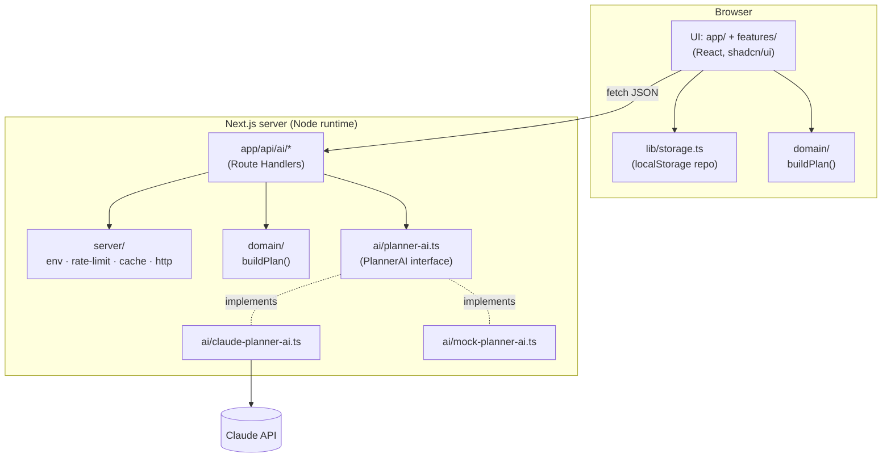

# 04: Architecture

## 4.1 Layers



`domain/` is the same module on both sides. The browser runs it to render the plan instantly.
The server runs it again so it never trusts a plan the client computed.

## 4.2 Dependency rules (enforced by ESLint `no-restricted-imports`)

| Module         | May import                         | MUST NOT import                                     |
| -------------- | ---------------------------------- | --------------------------------------------------- |
| `domain/`      | `zod`, other `domain/` files       | React, Next, `@anthropic-ai/sdk`, `ai/`, `server/`, `lib/`, browser globals |
| `ai/`          | `domain/`, `@anthropic-ai/sdk` (only in `claude-planner-ai.ts`), `zod` | React, `features/`, `app/` |
| `server/`      | `domain/`, `ai/`, `server-only`    | React, `features/`                                  |
| `app/api/`     | `server/`, `ai/`, `domain/`        | `features/`, `components/`                          |
| `features/`, `components/`, `lib/` | `domain/`, each other | `ai/`, `server/`, `@anthropic-ai/sdk`         |

These rules give us three guarantees:
- **The SDK is behind one adapter** (Rule 06.2). Only `ai/claude-planner-ai.ts` imports
  `@anthropic-ai/sdk`. Every other file depends on the `PlannerAI` interface.
- **Server code can't reach the client bundle.** `server/env.ts` and `ai/claude-planner-ai.ts`
  import `server-only`, so the build fails if client code ever imports them.
- **The domain is pure.** "Today" is passed in as an argument; nothing in `domain/` calls
  `Date.now()`. That makes every rule deterministic and easy to test (Rule 06.3).

## 4.3 Data flows

**A. Create a plan (no network call):**
1. The user submits the form. `EventBriefSchema` validates it in the browser.
2. The client calls `buildPlan(brief, today)` and gets a `PlanSkeleton` (budget, timeline,
   vendors, warnings).
3. The plan page renders immediately, and the brief is saved to `localStorage`.

**B. Load ideas (one Claude call):**
1. The ideas section shows a loading skeleton and calls `POST /api/ai/ideas` with `{ brief, today }`.
2. The route enforces the body-size limit, then the rate limit, then validates with Zod.
3. It rebuilds the skeleton on the server with `buildPlan`, and checks the response cache
   (keyed by brief + model + prompt version).
4. On a cache miss it calls `PlannerAI.generateIdeas(brief, skeleton)`. The adapter calls Claude
   with structured output, parses the result with Zod, and drops any reference to an unknown
   vendor or budget line.
5. The route returns `{ ideas, meta }`. The client saves the ideas alongside a hash of the brief,
   so it won't refetch them for an unchanged brief.
6. On any failure (`AI_DECLINED`, `AI_UNAVAILABLE`, rate limited) the page keeps the full
   rules-based plan and shows an explanation with a retry button.

**C. Refine (Claude with one tool):**
1. The chat panel sends `POST /api/ai/refine` with `{ brief, today, history, message }`.
2. Claude may call `update_event_brief`. The server applies the patch, re-validates it, rebuilds
   the plan and returns a summary to Claude (06 §6.5).
3. The route returns `{ reply, brief, briefChanged }`. If the brief changed, the client rebuilds
   the plan, saves it, and offers to refresh the ideas, because they were written for the old
   brief.

## 4.4 Efficiency decisions

- **No AI call on the critical path.** The first meaningful paint is the rules-based plan;
  Claude's output arrives into an already useful page.
- **One Claude call per plan.** It returns every idea field at once. There are no follow-up
  calls per section.
- **Caching.** The server keeps an LRU cache of ideas (200 entries, 1-hour TTL). The client skips
  the call when the brief hash hasn't changed. The stable system prompt is prompt-cached (06 §6.7).
- **Small client bundle.** Pages are Server Components by default. Only the form, tabs, chat and
  theme toggle are client components. There's no chart or date library (03 §3.3).
- **No N+1s or unbounded work.** Chat history is capped at 10 turns, the tool loop at 3 model
  turns, and request bodies at 16 KB.

## 4.5 Folder layout

```
src/
  app/
    layout.tsx  page.tsx (intake)  loading.tsx  error.tsx  not-found.tsx  globals.css
    plan/[id]/page.tsx            # plan view (reads the brief from storage)
    plans/page.tsx                # saved plans
    api/ai/ideas/route.ts
    api/ai/refine/route.ts
    api/health/route.ts
  domain/                         # pure TS; runs in browser and server
    brief.ts                      # EventBriefSchema + types
    dates.ts                      # date-only arithmetic
    budget.ts  timeline.ts  vendors.ts  warnings.ts
    build-plan.ts                 # buildPlan(brief, today): PlanSkeleton
    reference/                    # base splits, milestone templates, vendor catalog, reference costs
    __tests__/
  ai/
    planner-ai.ts                 # PlannerAI interface + error types
    claude-planner-ai.ts          # the only importer of @anthropic-ai/sdk
    mock-planner-ai.ts            # fixture-based, deterministic
    get-planner-ai.ts             # factory: picks the adapter from env
    prompts.ts                    # system prompts + PROMPT_VERSION
    schemas.ts                    # Zod schemas for Claude's output
    __tests__/
  server/
    env.ts                        # Zod-validated env, imports server-only
    rate-limit.ts  response-cache.ts  http.ts (error envelope, body-size guard)
  features/
    intake/  plan/  refine/  saved-plans/
  components/ui/                  # shadcn primitives
  lib/
    storage.ts  ics.ts  format.ts (Intl currency and date)
  styles/__tests__/theme-tokens.test.ts
e2e/                              # Playwright specs
docs/adr/                         # 0001-tech-stack, 0002-hybrid-rules-and-llm
plan/                             # this folder
engineering-rules/
```

## 4.6 Single source of truth (Rule 06.3)

**The `EventBrief` is the only state we store.** The `PlanSkeleton` is derived from it with
`buildPlan(brief, today)` and is never saved. Saved data is the brief, the ideas (tagged with a
hash of the brief they were written for), checkbox progress and the chat text. When the brief
changes, everything that derives from it updates automatically. The ideas are marked out of date
until they are refreshed.
